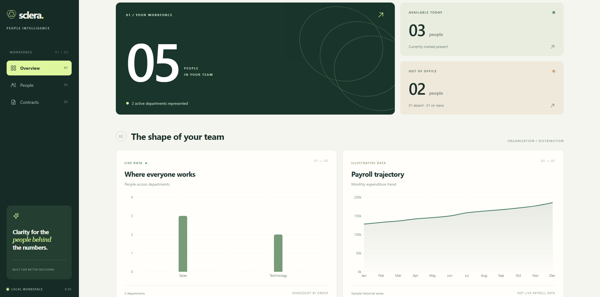
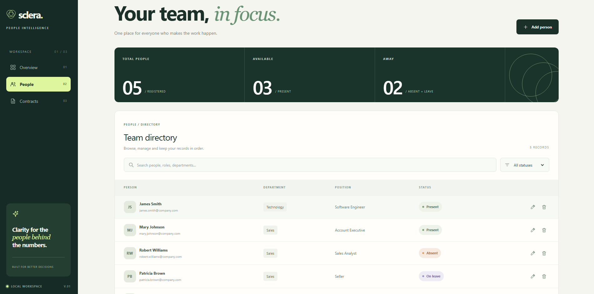

# Sclera

### People intelligence, made clearer.

**Sclera** is an independent full-stack web application for workforce management and HR analytics. It combines employee management, interactive dashboards, and data visualization in a modern, user-centered interface.

Built with React, TypeScript, Node.js, Express, and MySQL, the project explores the development of an end-to-end application, from frontend architecture and UI/UX design to REST API development and relational database modeling.

**Project status:** Active development.

### Try Sclera

**[Launch Live Demo](https://sclera-taupe.vercel.app/dashboard)**

Explore the workforce dashboard, employee directory, search, filters, and data visualizations directly in your browser.

The public demo uses fictional employee data and operates in read-only mode. No installation or account is required.

## Preview

### Workforce Dashboard



### Employee Management



## Features

### Workforce dashboard

- Employee metrics based on records retrieved from the API
- Attendance summaries covering present, absent, and on-leave employees
- Interactive department distribution charts using Recharts
- Payroll trend visualization using illustrative data

### Employee management

- Create, view, edit, and delete employee records
- Search employees by name, email, department, or position
- Filter employees by attendance status
- Manage employee information through a responsive interface

### Backend and database

- RESTful API built with Node.js, Express, and TypeScript
- MySQL integration for persistent employee records
- Relational department references using foreign keys
- CRUD operations with server-side validation and error handling
- Department identification by ID, with backward-compatible name-based requests

## Tech stack

| Layer              | Technologies                        |
| ------------------ | ----------------------------------- |
| Frontend           | React, TypeScript, JavaScript, Vite |
| Styling            | Tailwind CSS, CSS                   |
| Data visualization | Recharts                            |
| Backend            | Node.js, Express.js, TypeScript     |
| Database           | MySQL, SQL                          |
| API                | REST, JSON                          |
| Development        | Git, GitHub, ESLint                 |

## Getting started

Sclera currently runs locally using a React frontend, an Express API, and a MySQL database.

### Prerequisites

- Node.js and npm
- MySQL 8
- Git

### 1. Clone the repository

```bash
git clone https://github.com/NicholasBapt/Sclera.git
cd Sclera
```

### 2. Install dependencies

Install the frontend dependencies:

```bash
npm install
```

Then install the backend dependencies:

```bash
cd backend
npm install
cd ..
```

### 3. Set up MySQL

Create the database:

```bash
mysql -u root -p -e "CREATE DATABASE IF NOT EXISTS sclera_bi CHARACTER SET utf8mb4 COLLATE utf8mb4_unicode_ci;"
```

Import the database schema:

```bash
mysql -u root -p sclera_bi -e "SOURCE backend/database/schema.sql"
```

Populate the initial departments:

```bash
mysql -u root -p sclera_bi -e "SOURCE backend/database/seed.sql"
```

Replace `root` with your MySQL username if necessary. Your MySQL account must have the required database permissions.

On Windows, if `mysql` is not available in your PATH, use the full path to `mysql.exe`.

### 4. Configure environment variables

Copy the example configuration to `backend/.env`.

On Windows PowerShell:

```powershell
Copy-Item backend/.env.example backend/.env
```

On macOS or Linux:

```bash
cp backend/.env.example backend/.env
```

Edit `backend/.env` with your local MySQL connection settings:

```dotenv
DB_HOST=localhost
DB_PORT=3306
DB_USER=your_mysql_user
DB_PASSWORD=your_mysql_password
DB_NAME=sclera_bi
```

Never commit `.env` files containing real credentials.

### 5. Start the backend

From the project root:

```bash
cd backend
npm run dev
```

The Express API runs at:

http://localhost:3333

You can verify the server using:

http://localhost:3333/health

### 6. Start the frontend

Open a second terminal in the project root and run:

```bash
npm run dev
```

Open the local address displayed by Vite, typically:

http://localhost:5173

The frontend currently expects the API at `http://localhost:3333`.

### Notes

- Authentication is not implemented yet.
- Employee management requires a running MySQL database and backend API.
- Payroll visualizations currently use illustrative data.
- This project is under active development and is not intended for production use.

## Current development status

Sclera is an evolving portfolio project rather than a production-ready HR system.

Employee management, department integration, and the core workforce dashboard are implemented. Authentication, contract management, and additional analytics are planned for future development.

The dashboard currently combines live employee data from the local MySQL database with clearly identified illustrative payroll data.

## Development roadmap

- [ ] Complete the transition to department ID-based frontend requests
- [ ] Implement authentication and access control
- [ ] Develop the contract management module
- [ ] Expand workforce analytics
- [ ] Add automated testing and CI workflows
- [ ] Prepare a publicly accessible demonstration

---

**Developed by [Nicholas Baptista](https://www.linkedin.com/in/nicholasbaptista/)**

[GitHub Profile](https://github.com/NicholasBapt)
